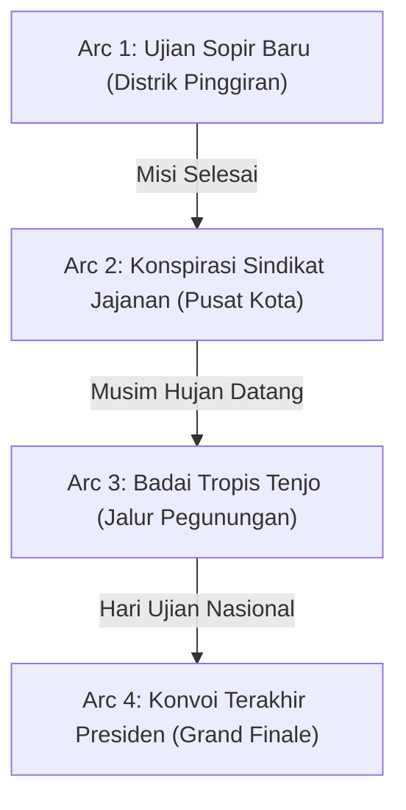

# DOKUMEN DESAIN NARATIF & NASKAH OPENING
# GAME: MBG EXPRESS MOBILE (TENJO ISLAND)

---

## 1. INFORMASI & SETTING CERITA
* **Judul Game**: MBG Express Mobile
* **Latar Dunia**: **Tenjo Island** — Sebuah negara kepulauan berkembang yang dipimpin oleh **Presiden Ari**, dengan cita-cita besar mencetak *"Generasi Emas 2045"* melalui program nasional **Makan Bergizi Gratis (MBG)**.
* **Fokus Narasi**: Perjalanan penuh komedi, dinamika sosial lokal, dan perjuangan heroik para driver pengantar makanan bergizi menghadapi macet, jalanan rusak, cuaca ekstrem, hingga sabotase para penolak program MBG.

---

## 2. PROFIL DRIVER (PILIHAN KARAKTER)
Setiap driver memiliki latar belakang, kepribadian, serta atribut *gameplay* (pasif) yang berbeda:

| Karakter Driver | Kepribadian & Latar Belakang | Efek Pasif Gameplay |
| :--- | :--- | :--- |
| **Fatur "Si Kilat"** | Mantan kurir paket kilat antar-pulau. Terbiasa berkendara cepat dan agresif, namun sedikit ceroboh. | **Akselerasi +15%**, kecepatan puncak lebih tinggi, namun guncangan sedikit lebih mudah memengaruhi Food HP. |
| **Mahdi "Si Kompas"** | Warga lokal yang hafal seluruh seluk-beluk gang tikus dan jalur rahasia Tenjo Island. | **Deteksi Rute Dini**: Mini-map menampilkan indikator macet lebih awal; handling di tikungan sempit lebih stabil. |
| **Zen "Si Tenang"** | Pengemudi senior berhati lembut, sangat teliti menjaga keutuhan wadah makanan. | **Supir Idaman**: Penurunan Food HP akibat jalan rusak/polisi tidur berkurang 20%. |

---

## 3. NASKAH SCENE OPENING: "TITAH PRESIDEN ARI"
*Scene ini muncul tepat setelah pemain memilih salah satu karakter di menu awal dan menekan tombol **Start Game**.*

```text
[FADE IN: LAYAR HITAM]
[AUDIO: Suara gemuruh drum orkestra berpadu dengan alunan musik tradisional jenaka]
[VISUAL: Peta kartun 2D Kepulauan Tenjo Island perlahan muncul di layar]

NARATOR (Teks berjalan di bawah layar):
"Dahulu kala, di sebuah negara kepulauan yang sedang berjuang melompat menjadi negara adidaya—Tenjo Island... 
Lahir sebuah program agung penyelamat masa depan bangsa: Makan Bergizi Gratis (MBG)."

NARATOR:
"Setiap fajar menyingsing, dapur pusat SPPG mengepulkan aroma 4 Sehat 5 Sempurna. 
Namun, jalanan Tenjo Island bukanlah lintasan balap biasa..."

[TRANSISI: CUTSCENE ISTANA KEPRESIDENAN TENJO]
[VISUAL: Ruang sidang megah. Presiden Ari berdiri tegak di depan meja kerjanya memakai jas kepresidenan berwibawa, memegang sendok dan garpu emas raksasa]
[VISUAL: Karakter pemain (Fatur / Mahdi / Zen) berdiri tegak di hadapannya memberi hormat]

PRESIDEN ARI:
"Dengarkan aku, wahai rakyatku! Tenjo Island tidak akan pernah menjadi macan dunia jika anak-anak sekolah kita kekurangan gizi dan terkantuk-kantuk saat belajar matematika!"

[PRESIDEN ARI MENGHAMPIRI DRIVER DENGAN WAJAH SERIUS TAPI JENAKA]

PRESIDEN ARI:
"Maka dari itu, aku secara khusus memilihmu, [NAMA_KARAKTER]! 
Intelijen istana baru saja melaporkan bahwa pagi ini jalanan kota sedang kacau balau: kemacetan horor, jalanan berlubang peninggalan proyek mangkrak, hingga komplotan demonstran bayaran yang mencoba menghadang distribusi makanan!"

PRESIDEN ARI:
"Di dalam bagasi mobil box itu, bukan sekadar nasi, ayam kecap, tumis bayam, dan susu kotak. 
Di sana terletak 'MASA DEPAN GENERASI EMAS TENJO ISLAND'!"

PRESIDEN ARI:
"Bawa mobil box ini! Terobos rintangan, jaga keutuhan makanan, bunyikan klaksonmu jika ada yang menghalangi, dan pastikan bel istirahat sekolah berbunyi dengan senyum anak-anak yang kenyang! 
Berangkat sekarang juga!"

[NAMA_KARAKTER]:
"Siap laksanakan, Pak Presiden! Makanan aman, anak-anak kenyang, Tenjo Island maju!"

[AUDIO: SFX Klakson Kencang "TET-TOOT!!"]
[VISUAL: Mobil Box MBG melesat kencang keluar dari gerbang istana menuju Dapur SPPG]
[FADE TO GAMEPLAY: LEVEL 1 START]
```

---

## 4. SISTEM PROGRESSION NARATIF (AGAR TIDAK MONOTON)
Agar alur cerita dari level ke level tidak repetitif, permainan dibagi menjadi **4 Arc Kampanye Utama** dengan eskalasi konflik yang bertingkat:



### Arc 1: "Ujian Pengemudi Baru" (Distrik Pinggiran & Perkampungan)
* **Latar Wilayah**: Pesisir dan perkampungan Tenjo Island.
* **Konflik Narasi**: Hari-hari pertama pembagian MBG. Penduduk masih adaptasi; jalanan sempit penuh dengan ayam kampung menyeberang, jemuran warga, dan polisi tidur liar.
* **Tantangan Gameplay**: Membiasakan diri dengan kontrol mobil, menjaga Food HP di jalan sempit, dan membunyikan klakson menyapa anak-anak di pinggir jalan (*"Om Klakson Om"*).
* **Ending Arc**: Presiden Ari memberi ucapan selamat via radio: *"Bagus! SD Tenjo 01 sudah makan telur rebusnya tanpa ada yang pecah!"*

### Arc 2: "Konspirasi Sindikat Jajanan Micin" (Distrik Perkotaan Padat)
* **Latar Wilayah**: Pusat Kota Tenjo, area perkantoran, dan pasar tumpah.
* **Konflik Narasi (Asal-usul Demonstran)**: Terungkap bahwa gelombang demonstrasi penolakan MBG bukan dari warga murni, melainkan didalangi oleh **"Sindikat Pedagang Jajanan Micin & Minuman Berpemanis Buatan"** yang omsetnya merosot drastis sejak ada program MBG gratis dari pemerintah!
* **Tantangan Gameplay**:
  * Komplotan demonstran memblokade jalan-jalan protokol utama.
  * Pemain harus mencari jalan pintas perumahan atau membunyikan klakson modifikasi untuk memecah kerumunan.
* **Ending Arc**: Mobil pickup box terbuka di garasi; bos sindikat jajanan mulai panik.

### Arc 3: "Badai Tropis Tenjo" (Jalur Pegunungan & Transisi Season Hujan)
* **Latar Wilayah**: Perbukitan tinggi dan daerah pelosok terpencil.
* **Konflik Narasi**: Musim hujan lebat melanda Tenjo Island. Tanah becek, jalanan licin, dan jarak pandang berkabut. Anak-anak di SD Puncak Bukit kedinginan dan sangat membutuhkan sup hangat MBG.
* **Tantangan Gameplay**:
  * Fisika jalanan basah (mudah tergelincir / *drifting*).
  * Tanjakan curam yang membutuhkan konsumsi bensin lebih tinggi.
  * Kompensasi koin **1.5x lipat** jika berhasil menuntaskan misi di cuaca buruk.

### Arc 4 (Grand Finale): "Hari Ujian Nasional Serentak"
* **Latar Wilayah**: Seluruh distrik (Pesisir, Kota, hingga Pegunungan).
* **Konflik Narasi**: Hari penentuan! Seluruh murid Tenjo Island menghadapi ujian kelulusan serentak. Presiden Ari sendiri turun langsung memantau konvoi dengan mobil dinas kepresidenan di belakang pemain.
* **Tantangan Gameplay**: *Multi-Drop Run* (mengantar makanan ke 3 sekolah sekaligus dalam satu batas waktu estafet).
* **Epilog Kemenangan**: Cutscene perayaan akbar di Istana Tenjo Island. Presiden Ari mengalungkan medali *"Supir MBG Legendaris"* kepada karakter pemain, diiringi sorak gembira anak-anak sekolah yang memamerkan nilai rapor terbaik mereka.

---

## 5. DINAMIKA LELUCON DI JALAN: RADIO ISTANA & DIALOG FINISH

### 5.1 Breaking News Radio Istana (Muncul di Banner HUD saat Menyetir)
* *"Radio Tenjo: Peringatan bagi seluruh warga, kemacetan di Jl. Mangga diakibatkan oleh rombongan bebek yang menyeberang dengan tertib."*
* *"Radio Tenjo: Presiden Ari menegaskan, driver yang ketahuan mencolek sambal di bagasi akan disanksi push-up 50 kali!"*
* *"Radio Tenjo: Cuaca hari ini diprediksi mendung berawan, cocok untuk makan nasi kotak MBG bersama gebetan."*

### 5.2 Reaksi Guru di Sekolah (Berdasarkan Sisa Food HP):
* **Food HP 80% - 100% (Sempurna - Bintang 3)**:  
  * *Guru:* "Luar biasa! Sayurnya masih segar dan susunya masih dingin! Terima kasih Pak Driver, anak-anak pasti senang!"
* **Food HP 50% - 79% (Cukup - Bintang 2)**:  
  * *Guru:* "Alhamdulillah sampai tepat waktu. Tapi ini kenapa tempenya nempel di tutup kotak ya Mas? Agak ugal-ugalan ya tadi?"
* **Food HP < 50% (Gagal - Bintang 0)**:  
  * *Guru:* "Astaga Mas! Ini nasi kotak atau es campur? Semuanya tumpah dan berantakan begini! Anak-anak tidak boleh makan makanan rusak!" *(MISSION FAILED)*

---

## 6. PANDUAN TEKNIS IMPLEMENTASI DI GODOT 4.X
1. **Scene Cutscene Opening (`OpeningCutscene.tscn`)**:
   * Gunakan node `CanvasLayer` dengan `TextureRect` untuk menampilkan latar Istana dan portrait Presiden Ari.
   * Gunakan node `Label` dengan properti `visible_characters` yang dianimasikan menggunakan `AnimationPlayer` atau `Tween` untuk menciptakan efek mesin tik (*typewriter effect*).
2. **Audio Controller (`AudioManager.gd`)**:
   * Putar background music bertema kepresidenan jenaka (`res://audio/bgm_palace.mp3`).
   * Mainkan SFX klakson dan deru mesin di akhir dialog sebelum berganti ke `res://scenes/MainLevel.tscn`.
